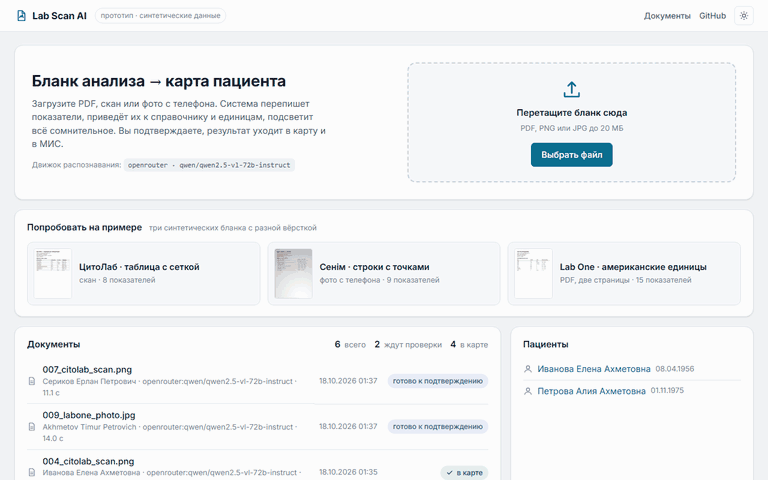
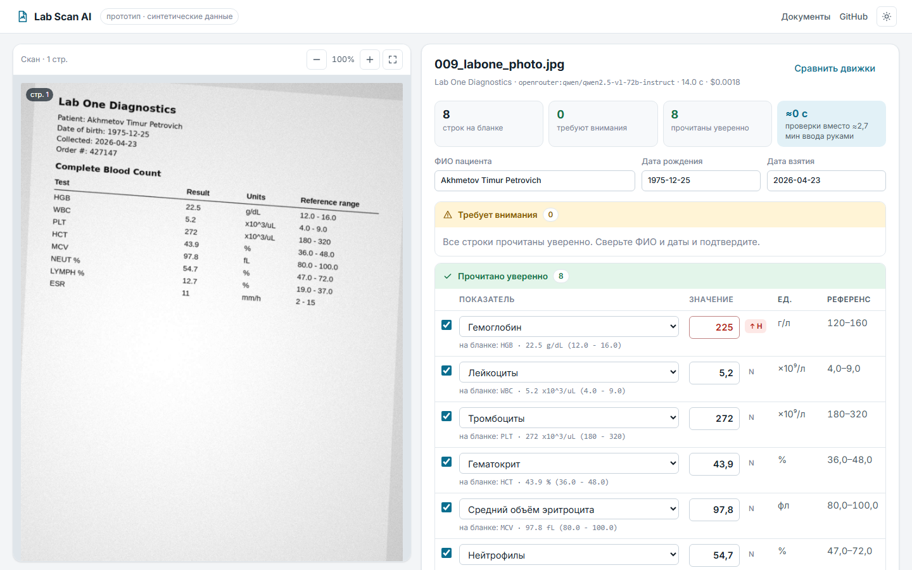
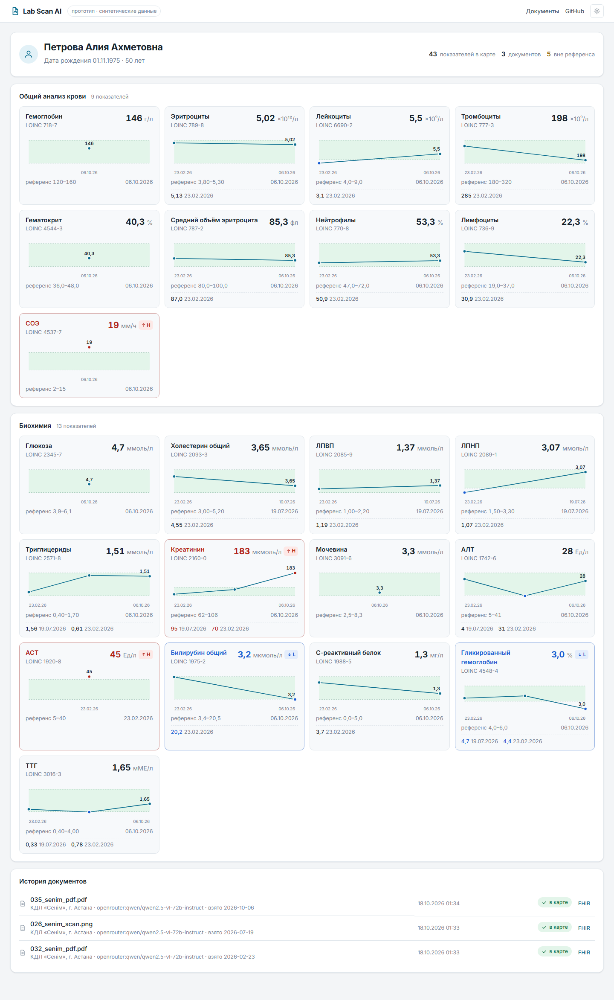
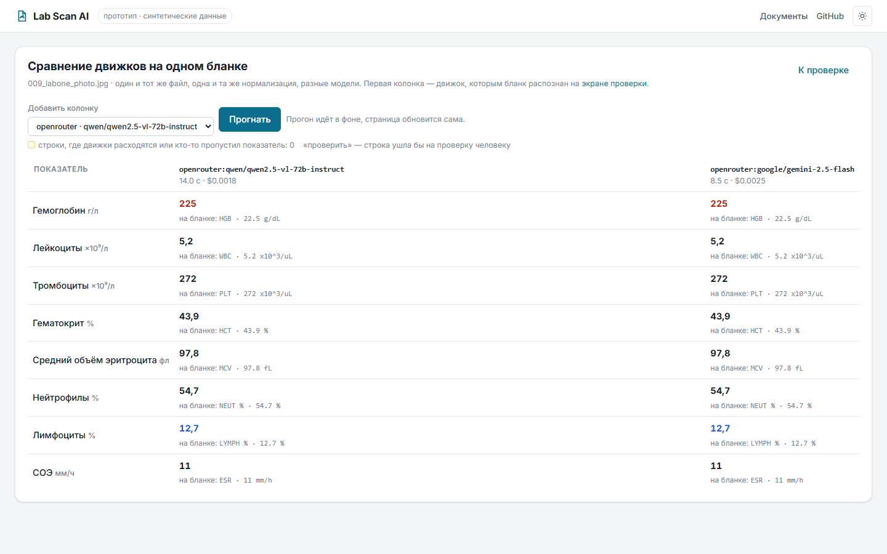

# Lab Scan AI

Прототип для клиники: **ИИ читает сканы и фото бланков анализов и раскладывает показатели в карту пациента.** Врач или регистратор загружает бланк, система распознаёт показатели, приводит их к справочнику и единицам, подсвечивает всё сомнительное, человек подтверждает, результат уходит в карту и в МИС в формате FHIR.

Все бланки синтетические: генератор рисует их сам, поэтому у каждого есть эталон и качество измеряется честно, без доступа к данным клиента.



Экран проверки на живой vision-модели (фото бланка с телефона, американские единицы переведены в принятые в РК): скан с масштабом слева, строки справа, сомнительное сверху с причиной, строка в фокусе подсвечивается на скане. [Тёмная тема](docs/review-dark.png), [карта пациента](docs/patient.png), [сравнение движков на одном бланке](docs/compare.png).



## Что внутри

```
загрузка (PDF / фото / скан)
   → страницы-изображения
   → распознавание: Claude vision | OpenRouter (Qwen-VL и др.) | локальная модель (Ollama) | Tesseract OCR
        модель только ПЕРЕПИСЫВАЕТ бланк по JSON-схеме: название, значение, единица, референс как напечатаны
   → нормализация (детерминированный код, покрыт тестами):
        справочник показателей с синонимами и LOINC, перевод единиц (g/dL → г/л, mg/dL → ммоль/л …)
   → проверки: физиологические пределы, нераспознанная единица, неуверенное чтение,
        дубли, дата в будущем → статус «проверить» с причиной
   → экран проверки: скан слева, поля справа; сомнительное сверху с причиной, уверенное свёрнуто,
        строка в фокусе подсвечена на скане, пропущенное можно добавить
   → карта пациента: графики динамики с референсной полосой, панели ОАК и биохимии, история документов
   → FHIR R4 Bundle (Patient + Observation) → адаптер МИС
```

| Модуль | Что делает |
|---|---|
| `labscan/catalog.py` | Справочник 22 показателей ОАК и биохимии: синонимы, LOINC, единицы, коэффициенты перевода, физиологические пределы |
| `labscan/extractors/` | Четыре движка распознавания за одним интерфейсом: `claude.py`, `openrouter.py`, `ollama.py`, `tesseract.py` |
| `labscan/normalize.py` | Из «как напечатано» в «можно писать в карту» + все проверки |
| `labscan/fhir.py`, `labscan/mis.py` | Выгрузка в FHIR и адаптер МИС (в прототипе пишет в папку «исходящие», идемпотентно) |
| `labscan/web/` | FastAPI + Jinja + один CSS без сборки: загрузка, проверка, карта пациента, JSON API. Светлая и тёмная тема, распознавание в фоне |
| `synth/generate.py` | Генератор бланков: 3 вымышленные лаборатории с разной вёрсткой, скан / «фото с телефона» / многостраничный PDF |
| `evals/run_eval.py` | Метрики качества против эталона |

## Запуск

```bash
pip install -e ".[dev]"          # + tesseract-ocr и tesseract-ocr-rus для офлайн-движка
python -m synth.generate --n 50  # бланки в data/synth
uvicorn labscan.web.app:app --reload
# http://localhost:8000 → загрузить любой файл из data/synth
```

Или в Docker: `docker compose up --build`.

Движок выбирается переменной `LABSCAN_ENGINE` (`auto` по умолчанию):

| Движок | Что нужно | Когда |
|---|---|---|
| `claude` | `ANTHROPIC_API_KEY` | Лучшее качество, облако. Модель задаётся `LABSCAN_CLAUDE_MODEL` |
| `openrouter` | `OPENROUTER_API_KEY` | Любая vision-модель через OpenRouter, оплата без зарубежной карты. По умолчанию Claude Haiku 5.5: лучшая и самая дешёвая по eval ниже. Модель задаётся `LABSCAN_OPENROUTER_MODEL`, например `qwen/qwen2.5-vl-72b-instruct` или `google/gemini-2.5-flash` |
| `ollama` | Запущенный [Ollama](https://ollama.com) и `ollama pull qwen2.5vl:7b` | Данные не покидают сервер клиники. `docker compose --profile local-llm up` |
| `tesseract` | Ничего, работает офлайн | Базовая линия без LLM, для сравнения |

`auto`: Claude, если есть ключ Anthropic, иначе OpenRouter, иначе Ollama, если запущен, иначе Tesseract.

## Интерфейс

- **Главная.** Перетащите файл или нажмите на один из трёх синтетических бланков: скан с сеткой, фото с телефона, двухстраничный PDF с американскими единицами. Список документов со статусами: распознаётся, проверить, в карте.
- **Проверка.** Скан с масштабом слева, строки справа. Строки, которым нужен человек, сверху с причиной пометки («единица не распознана», «вне физиологических пределов», «неуверенное чтение»); уверенные свёрнуты. Флаги H/L цветом и значком. Строка в фокусе подсвечивается на скане (Tesseract отдаёт координаты, у vision-моделей их можно запросить флагом `LABSCAN_LLM_BOX=1`). Сверху оценка: сколько секунд займёт проверка вместо ручного ввода. Горячие клавиши: `Enter` подтвердить, `Tab` следующее поле, `+`/`−` масштаб.
- **Карта пациента.** Панели ОАК и биохимии, у каждого показателя график динамики с референсной полосой и точками по флагу, история документов со ссылкой на FHIR Bundle.
- **Сравнение движков.** С экрана проверки тот же бланк можно прогнать другим движком или моделью (что доступно по ключам: Claude, модели OpenRouter, Ollama, Tesseract) и увидеть построчно, где они расходятся и кто что пропустил. Список моделей для кнопки задаётся `LABSCAN_COMPARE_MODELS`.
- Распознавание идёт в фоне: страница ожидания показывает скан и опрашивает статус, ошибка движка становится статусом документа с кнопкой «повторить».

## Качество

```bash
python -m evals.run_eval --engine tesseract
python -m evals.run_eval --engine claude --limit 20
python -m evals.run_eval --engine openrouter --limit 20
python -m evals.run_eval --engine ollama
```

Главная метрика — **тихие ошибки**: неверное значение, которое система не пометила на проверку. Ошибка, пойманная проверкой, стоит врачу пять секунд. Тихая ошибка попадает в карту пациента.

Все движки на одних и тех же первых 20 бланках `data/synth` (202 показателя; Tesseract прогнан на всех 50, здесь его срез по тем же 20). Сводная таблица: [evals/results/comparison.md](evals/results/comparison.md), отчёт по каждому движку в [evals/results](evals/results).

| | Tesseract | Claude Haiku 5.5 | Gemini 2.5 Flash | Qwen2.5-VL 72B | Qwen3-VL 235B | GPT-4o-mini |
|---|---|---|---|---|---|---|
| Показатель распознан верно | 66.3% | **100%** | 100% | 100% | 100% | 97.5% |
| Ошибка поймана проверкой | 10.4% | 0 | 0 | 0 | 0 | 1.0% |
| Тихая ошибка | 1.5% | 0 | 0 | 0 | 0 | 1.0% |
| Показатель пропущен | 21.8% | 0 | 0 | 0 | 0 | 0.5% |
| Бланк без единой пометки и полностью верный | 15% | 100% | 100% | 100% | 100% | 65% |
| Бланк без пометок, но часть строк молча пропущена | 20% | 0 | 0 | 0 | 0 | 0 |
| ФИО и дата взятия верны | 75% | 100% | 100% | 100% | 100% | 90% |
| Секунд на страницу | 3.3 | 7.1 | 9.0 | 14.4 | 17.5 | 8.4 |
| Цена страницы, $ | 0 | 0.0008 | 0.0042 | 0.0029 | 0.0016 | 0.0059 |

Что видно:

- OCR без LLM на чистых сканах даёт ~77%, на фото с телефона разваливается (44% верно, 46% пропущено), единицы вида «×10⁹/л» читает с ошибками. Пропущенные строки OCR не видит вообще: каждый пятый бланк проходит «без пометок», хотя часть строк потеряна.
- Vision-модели читают таблицу целиком. Четыре из пяти дали 100% на всех 202 показателях, включая фото и американские единицы. Claude Haiku 5.5 при этом самая быстрая и в 2–7 раз дешевле остальных, поэтому она по умолчанию для OpenRouter.
- Единственная тихая ошибка у GPT-4o-mini: на фото сдвинул строки, значение MCV записал в нейтрофилы, нейтрофилы в лимфоциты. Две из трёх строк проверки поймали (единица не сходится, значение не читается), а «лимфоциты 54,7 %» прошли как правдоподобные. Ровно поэтому тихие ошибки считаются отдельно.
- Часть «ошибок» первых прогонов оказалась ошибками нормализации, а не чтения, и закрыта детерминированным кодом: Gemini пишет «ACT» латиницей вместо «АСТ», Qwen2.5-VL пишет «мME/л» вперемешку и «Гликозированный гемоглобин», Qwen3-VL режет единицу пополам («8.10 ×10¹²» в значении, «/л» в единице). Сырой ответ модели хранится в JSON прогона, поэтому такие правки проверяются `--rescore` без обращения к модели.
- Бесплатный Nemotron 3.5 Super VL (`:free`) на тех же бланках дал 96.5% верно и 0 тихих ошибок, но 37 секунд на страницу и лимит 50 запросов в день ([отчёт](evals/results/openrouter_nvidia_nemotron-3.5-super-vl_free.md)). ФИО он «поправлял» («Эрлан» вместо «Ерлан»); платные модели ФИО не трогали, но для карты пациента это всё равно аргумент за сопоставление по ИИН (см. DECISIONS).

Прогон: `python -m evals.run_eval --engine openrouter --limit 20` с нужной `LABSCAN_OPENROUTER_MODEL`; упавшие из-за сети бланки дозапускаются `--retry`; сводная таблица `python -m evals.compare --limit 20`.

## Что показать клиенту

1. Живое демо: загружаем бланк, через несколько секунд показатели в карте, сомнительное подсвечено.
2. Таблицу качества на **их** 30–50 обезличенных бланках: та же команда eval, только с их эталоном.
3. Стоимость и время на страницу (eval считает по токенам).
4. План до пилота: адаптер МИС клиента, локальная модель при требованиях к данным, очередь распознавания, логирование правок врачей (уже пишется в таблицу `corrections`).

Почему сделано именно так: [DECISIONS.md](DECISIONS.md).





## Тесты

```bash
ruff check . && pytest -q
```

68 тестов: справочник и единицы, нормализация и проверки, JSON-схема и запрос к Claude (на фейковом клиенте), разбор строк OCR, весь путь загрузка → проверка → карта → FHIR, примеры и график динамики. CI в GitHub Actions дополнительно прогоняет eval на 15 бланках и пишет таблицу в summary.
